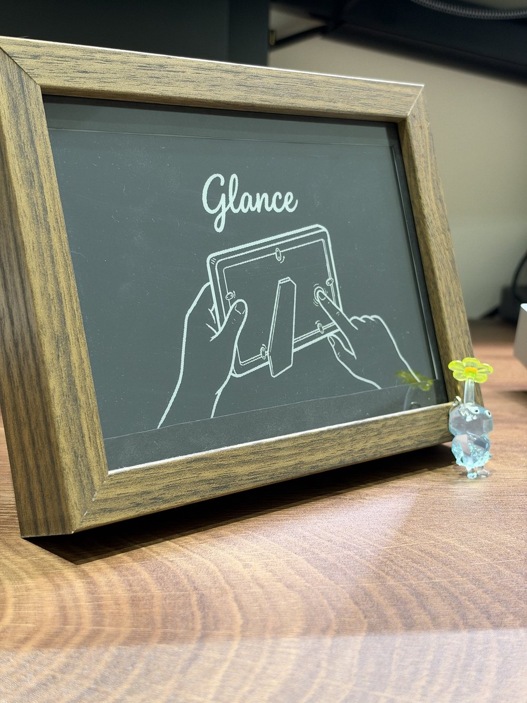
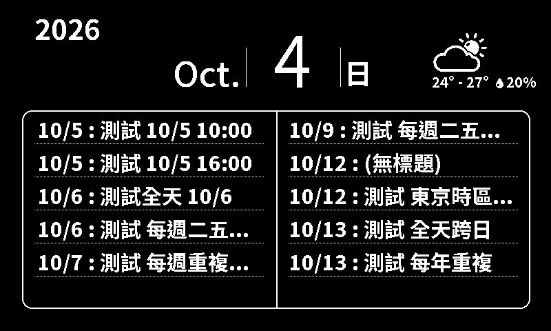
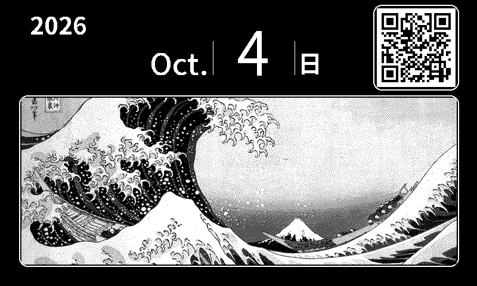

# Glance

**繁體中文** | [English](README.en.md)

**住在相框裡的行事曆。** Glance 是一台電子紙顯示器，只顯示今天的日期、天氣，和接下來的十個行程，其他什麼都沒有。它每天自己更新一到兩次，充一次電可以用很久，放在架上看起來像一幅畫，而不是一台電子產品。

## 它會顯示什麼

| 行事曆 | 隱私模式 |
|---|---|
|  |  |
| 今天的日期、當天的天氣，以及最多五個行事曆（Google 日曆、iCloud，或任何有 iCal 連結的行事曆）合併後的接下來十個行程。只顯示日期和標題，細節看手機就好。 | 有客人要來？按一下按鈕，行程就換成一張照片。可以從手機上傳自己的照片，或用內建的兩幅葛飾北齋浮世繪。右上角可以放天氣，或給朋友掃的 WiFi QR code。 |

其他功能：

-   **相簿模式**：完全不設定行事曆的話，就顯示你的照片，加上日期和天氣。
-   **訪客 WiFi**：隱私模式時可以顯示一個 QR code，朋友用手機掃描就能連上你的 WiFi（建議用路由器的訪客網路）。
-   **深色或淺色**：黑底白字或白底黑字，照片也會自動配上讓它更清楚的背景。
-   **自訂更新時間**：預設每天 07:00，也可以改成任何時間，還能加一個傍晚的第二次更新，那一次會顯示明天的天氣。
-   **自己保持在最新版**：新的韌體會透過 WiFi 自動更新。
-   **只在出問題時提醒你**：連不上網路、某個行事曆抓不到，或電池快沒電時，角落才會出現一個小圖示。

## 怎麼使用

**設定**只需要一支手機、幾分鐘，面板上不用文字，用圖告訴你下一步：

1.  按一下背面的按鈕，畫面出現 QR code。用手機相機掃描，連上 Glance 自己的 WiFi，在跳出的頁面選你家的 WiFi。
2.  畫面出現第二個 QR code。把手機切回家裡的 WiFi（這樣才有網路），掃描它，貼上行事曆連結、選天氣的縣市，想放照片也可以順便上傳。
3.  完成。Glance 會畫出你的行事曆，然後睡到下一次更新。

**背面的按鈕：**

| 操作 | 會發生什麼 |
|---|---|
| 按一下 | 在行事曆和隱私模式之間切換 |
| 按住約 5 秒 | 再次開啟設定頁（改行事曆、WiFi、照片……） |
| 按住約 20 秒 | 清除所有資料，送給別人之前使用；設定頁打不開時也能用這個重來 |

秒數不用很準：按住 3 到 15 秒之間放開就是開設定頁，15 到 30 秒之間放開才會清除，超過 30 秒會當成按鈕卡住、什麼都不做。默數 5 秒、20 秒剛好落在中間，裝進相框看不到指示燈時也很穩。

**充電**用 USB-C。大約在沒電前兩個月，角落會出現電池圖示；真的沒電時，畫面會提醒你充電，充好之後 Glance 會自己恢復。

## 電池續航

Glance 幾乎一直在睡覺，只有更新畫面時才醒來。電子紙就算斷電，畫面也會一直留著。

| | |
|---|---|
| 睡眠 | 約 27 µA |
| 更新一次（約 12 秒） | 約 0.16 mAh |
| 一天更新一次 | 約 0.8 mAh |

用 1000 mAh 的電池，紙面上算起來超過三年。實際的電池會慢慢自己放電，照片畫面也比較耗電，所以保守估計**充一次電可以用一年以上**。2026 年 10 月開始的長期測試會給出實際的數字。

## 隱私

Glance 只會連到你的行事曆連結、氣象署、校時伺服器，以及 GitHub（檢查更新）。沒有帳號，也沒有自己的雲端服務。WiFi 密碼和行事曆連結只存在裝置裡，但沒有加密；家裡 WiFi 上的設定頁是一般的 HTTP，用一次性的驗證碼保護。詳細內容，以及 Glance 沒有防護的部分，寫在[韌體說明](firmware/README.md#security-notes)（英文）。

## 自己做一台

需要 Glance 電路板、Waveshare 7.5 吋電子紙面板（V2，800×480，黑白）、1000 mAh 鋰電池和一個相框。天氣功能需要中央氣象署的免費 API 授權碼（可選）。

-   [`hardware/`](hardware/README.md)：電路板的電路圖、零件、電源設計和腳位（英文）。
-   [`firmware/`](firmware/README.md)：軟體的編譯和燒錄、每個功能的運作方式、安全性說明（英文）。

Glance 是自己做、在家裡用的個人專案，沒有在任何地方販售。

---

## 授權

Copyright (c) 2025 Bo Lin

本作品採用 Creative Commons 姓名標示-非商業性-相同方式分享 4.0 國際授權條款（CC BY-NC-SA 4.0）。你可以自由分享、改作，條件是：標示原作者（Bo Lin）、不用於商業目的、改作後以相同授權釋出。完整條款請見：
https://creativecommons.org/licenses/by-nc-sa/4.0/

（英文版的授權說明見 [README.en.md](README.en.md#license)，以英文版及完整條款為準。）
